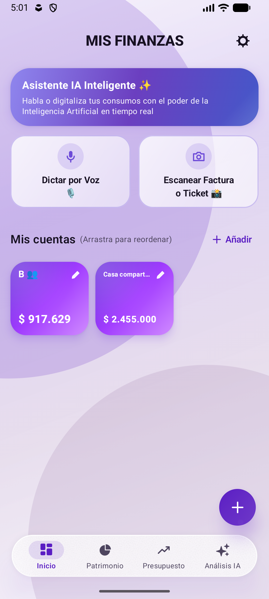
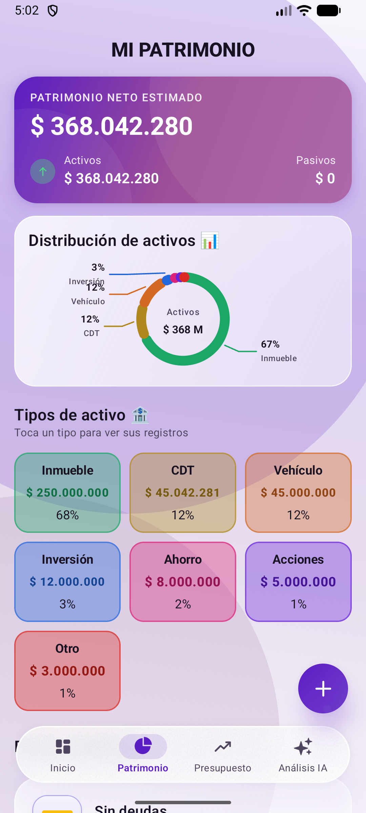
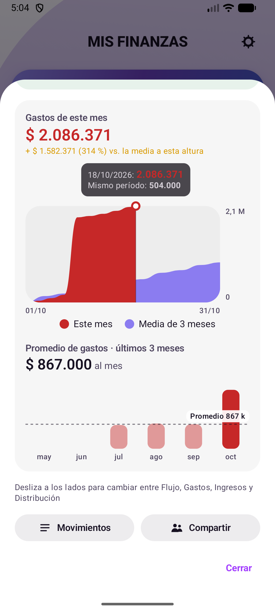
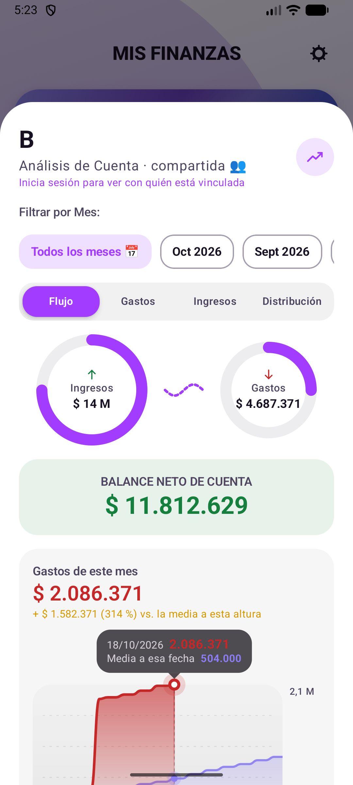

# Kapi — Finanzas personales con IA para Android

Aplicación Android nativa para administrar cuentas, gastos, presupuestos y patrimonio, con un asistente de inteligencia artificial que lee recibos, registra movimientos por voz y analiza las finanzas.

## Problema que resuelve
Llevar las cuentas a mano es tedioso, y por eso casi nadie lo sostiene. Kapi reduce el registro a una foto del recibo o una frase dicha en voz alta, y convierte los datos en gráficos y recomendaciones que muestran a dónde se va el dinero y cuánto se puede gastar con seguridad.

## Tecnologías
- **Kotlin**, **Jetpack Compose** y **Material 3**, con desenfoque real en la barra inferior (Haze)
- **Room** (base de datos local) y **DataStore**
- **Firebase Authentication** (ingreso con Google) y **Cloud Firestore** (sincronización y cuentas compartidas)
- **ML Kit Text Recognition** (OCR de recibos en el dispositivo) y **Gemini API** o **Claude API** (SDK oficial de Anthropic para Java), a elección de la persona y con su propia clave
- Google Play Billing (Kapi Premium) y AdMob
- WorkManager, Navigation Compose, Coroutines

## Funcionalidades principales
- Cuentas, categorías, movimientos, transferencias y plantillas frecuentes.
- **Patrimonio**: activos, CDT (muestra el capital), inversiones y deudas, con gráfico de distribución.
- Presupuestos con semáforo, gastos fijos y suscripciones, metas.
- Gráficos de gastos: ritmo del mes frente al promedio de 3 meses y comparación mensual.
- **Asistente con IA**:
  - escaneo de recibos (cámara o galería) con OCR + IA, revisión antes de guardar y opciones «Leer de nuevo» y «Otra foto»;
  - registro rápido por voz;
  - análisis por cuenta y de todas las finanzas;
  - chat con historial de conversaciones.
- Ingreso con Google, modo invitado, cuentas compartidas y sincronización en la nube.
- Bloqueo con huella o PIN, recordatorios, exportación CSV y copia de seguridad.
- Temas claro y oscuro con varias paletas.

## Capturas de pantalla
| Inicio de sesión | Inicio | Patrimonio |
|---|---|---|
|  |  |  |

| Gastos del mes | Análisis de cuenta | Asistente IA |
|---|---|---|
|  |  |  |

## Instalación y uso
**Requisitos:** Android Studio (o JDK 21 + Gradle 9.3), Android SDK 36, Android 8.0 (API 26) o superior.

1. Clona el repositorio:
   ```bash
   git clone https://github.com/ricardoprs76-max/kapi.git
   ```
2. Crea un proyecto en [Firebase](https://console.firebase.google.com), registra la app Android `com.aura.finanzas` con el SHA-1 de tu clave de firma, activa **Authentication → Google** y **Firestore**, y copia tu `google-services.json` en `app/`. Las reglas de Firestore y la página de privacidad están en `web/`.
3. Compila:
   ```bash
   gradle assembleRelease   # o assembleDebug
   ```
   o abre la carpeta en Android Studio y pulsa *Run*.
4. Para las funciones de IA, elige el proveedor (Gemini o Claude) e ingresa tu propia clave en **Más → Inteligencia artificial**.

> Los identificadores de AdMob de este repositorio son los de **prueba** de Google. Para publicar, cámbialos por los de tu cuenta en `AndroidManifest.xml` y `ui/components/Ads.kt`.

## Contacto
**Ricardo Augusto Porras Díaz** — Desarrollador de software y abogado especialista en derecho administrativo
- Correo: [ricardoprs76@gmail.com](mailto:ricardoprs76@gmail.com)
- GitHub: [github.com/ricardoprs76-max](https://github.com/ricardoprs76-max)
